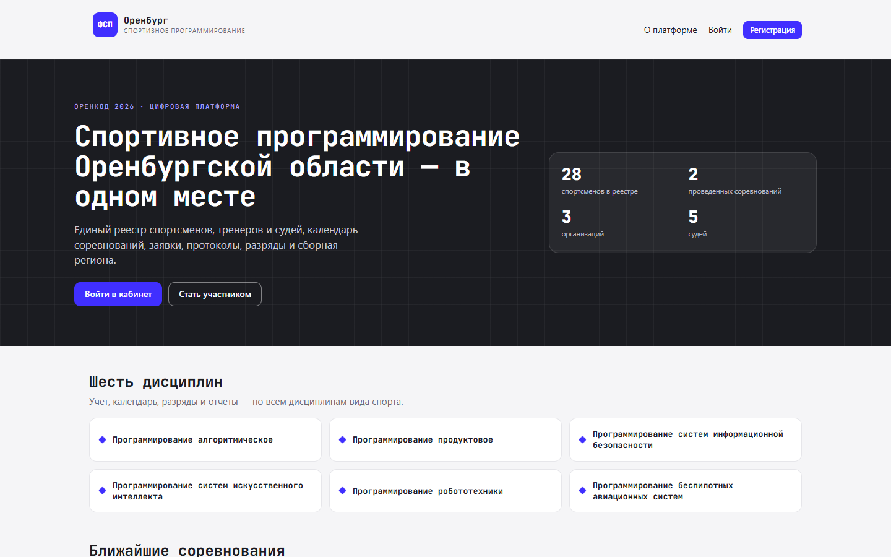
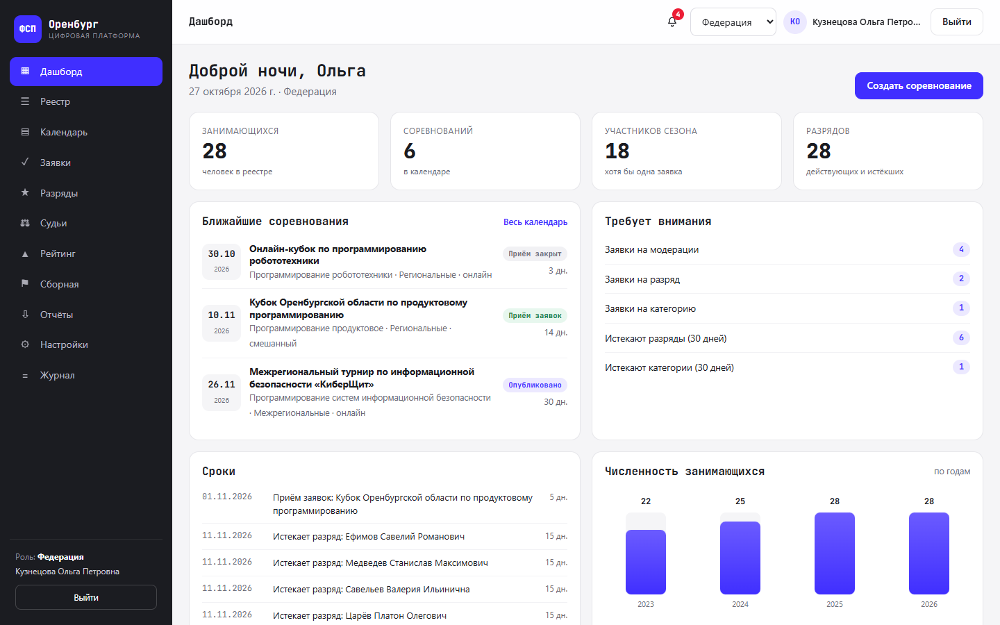
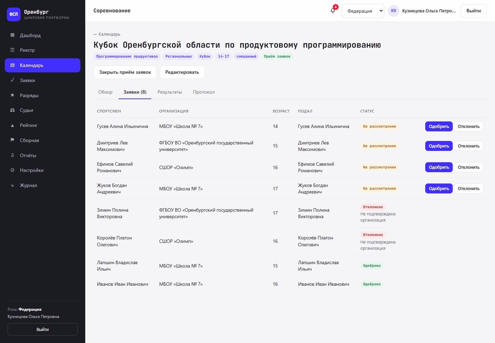
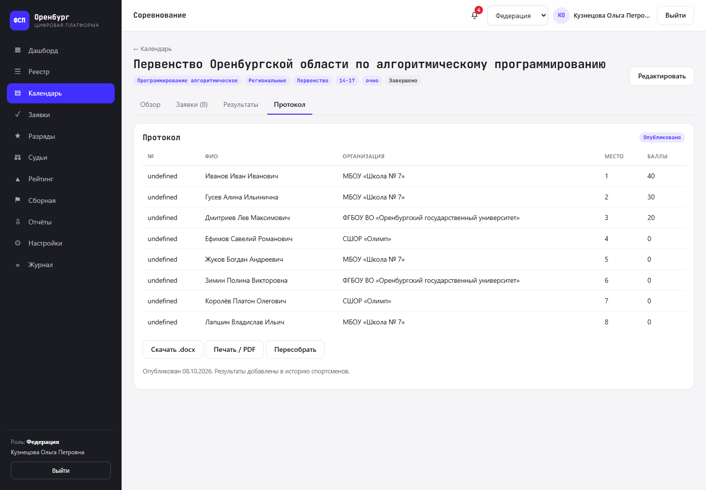
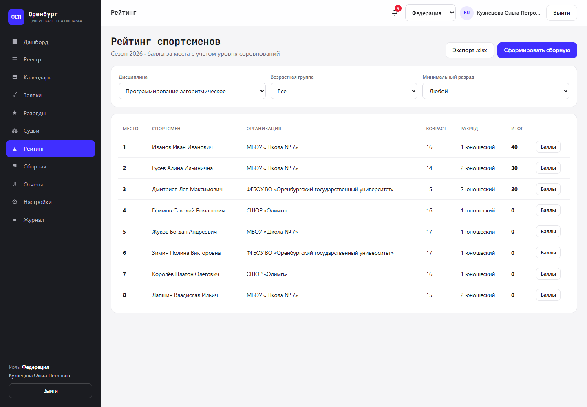
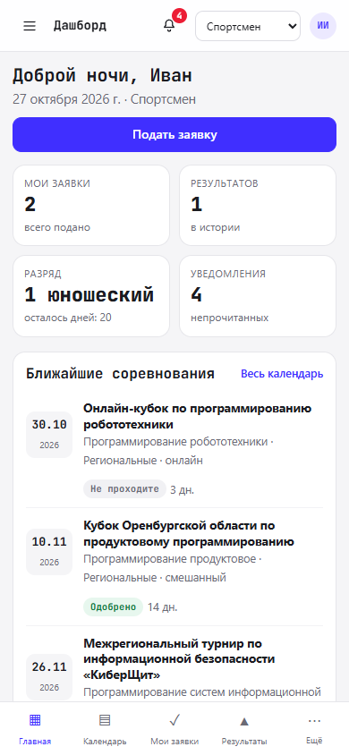

# Единая цифровая платформа ФСП Оренбургской области

Демонстрационная версия платформы регионального отделения Федерации спортивного
программирования Оренбургской области. Кейс «ОренКод 2026».

Платформа ведёт учёт спортсменов, тренеров, судей и организаций, календарь
соревнований и заявки, результаты и протоколы, разряды и судейские категории,
реестр занимающихся с отчётом о динамике численности, рейтинг и сборную региона.

Все персональные данные вымышлены.

## Скриншоты

| Публичная часть | Дашборд федерации |
|---|---|
|  |  |

| Карточка соревнования | Протокол |
|---|---|
|  |  |

| Рейтинг | Смартфон |
|---|---|
|  |  |

---

## Что реализовано

**Обязательный функционал кейса (пункты 1–8):**

1. Фронт-система: адаптивный интерфейс в стилистике ФСП, шесть дисциплин.
2. Бэк-система: REST API, управление процессами и контентом.
3. Личные кабинеты: федерация, спортсмен, тренер, судья; несколько ролей у одного
   аккаунта и переключение без повторного входа.
4. Календарь, заявки, судейские коллегии, протоколы, история выступлений.
5. Разряды и судейские категории: заявки, присвоение, контроль сроков, уведомления.
6. Реестр занимающихся и отчёт о динамике численности (`.xlsx`).
7. Рейтинг спортсменов и формирование сборной региона (проект приказа `.docx`).
8. Документы и отчёты по заданным формам.

Дополнительно: уведомления (кабинет + письмо), журнал действий, согласия на
обработку персональных данных, контроль сроков и антидопинговый блок РУСАДА.

**Дополнительные сценарии:**

- **Д9. Кабинет министерства спорта** — доступ только для чтения к отчётам,
  календарю и сборной.
- **Д10. Справка об участии с QR-кодом** — спортсмен формирует сам, есть номер и
  публичная страница проверки подлинности.
- **Д11. Навигатор для новичка** — публичный раздел без авторизации.
- **Д12. Документы о судействе** — справка о составе судейской коллегии и отчёт
  о соревнованиях судьи.

**Собственные решения:** публичная проверка справки по коду, экспорт реестра в
`.xlsx`, сводка «Требует внимания» с переходами к задачам, автоматическая
проверка возраста при подаче заявки, подсветка возможного разряда по результату.

---

## Стек

- **Node.js ≥ 20**, Express, express-session, bcryptjs.
- **Хранилище:** один файл `data/db.json` (чтение в память, запись целиком).
- **Фронтенд:** HTML + CSS + ES-модули без сборки, hash-роутинг.
- **Документы:** `exceljs` (xlsx), `docx` (docx), `qrcode` (QR), PDF — через
  печать страницы.

Никаких сборщиков, ORM, Docker и внешних сервисов.

---

## Запуск на другом компьютере

Нужно: **Node.js 20+** ([nodejs.org](https://nodejs.org), LTS) и Git — либо
просто скачать ZIP-архив репозитория.

```bash
git clone https://github.com/<логин>/orencode-2026-fsp.git
cd orencode-2026-fsp
npm install
npm start
```

Открыть <http://localhost:3000> и войти под демо-аккаунтом.

- База `data/db.json` уже лежит в репозитории — `npm run seed` **не обязателен**.
  Он нужен, только чтобы пересоздать демо-данные (даты тогда будут считаться
  относительно сегодняшнего дня).
- Без Git: на странице репозитория **Code → Download ZIP**, распаковать, затем
  те же `npm install` и `npm start` в папке проекта.
- Windows, macOS и Linux — одинаково.
- Порт меняется переменной `PORT`.

### Если не запускается

| Симптом | Что сделать |
|---|---|
| `node` не найден | Перезапустить терминал и проверить `node -v` |
| Версия Node ниже 20 | Установить актуальный LTS |
| `EADDRINUSE: port 3000` | Порт занят: `PORT=3001 npm start` (PowerShell: `$env:PORT=3001; npm start`) |
| Пусто после входа, нет данных | Выполнить `npm run seed` |
| `npm install` падает | Проверить интернет/прокси, удалить `node_modules` и `package-lock.json`, повторить |
| Страница не открывается | Адрес `http://localhost:3000`; сервер должен оставаться запущенным |

**Проверка с телефона (Android):** компьютер и телефон в одной Wi-Fi сети,
узнать IP компьютера (`ipconfig` → IPv4), открыть `http://<IP>:3000`.
Сервер слушает `0.0.0.0`.

---

## Демо-аккаунты

Пароль у всех — `demo123`.

| Логин | Роли |
|---|---|
| `federation` | федерация |
| `athlete` | спортсмен |
| `trainer` | тренер |
| `judge` | судья |
| `multi` | спортсмен + тренер + судья (переключение ролей) |
| `ministry` | министерство (только чтение) |

---

## Сквозной сценарий (2 минуты)

1. Войти как `federation`.
2. «Календарь» → «Кубок Оренбургской области по продуктовому программированию»
   (статус «Приём заявок»).
3. Вкладка «Заявки» — одобрить заявку спортсмена.
4. Вкладка «Результаты» → «Заполнить результаты» → «Сохранить результаты».
5. Вкладка «Протокол» → «Сформировать протокол» → «Опубликовать».
6. Войти как `athlete`: «Результаты» — появилось место, «Уведомления» — событие.
7. «Документы» → сформировать справку → открыть QR.
8. Открыть QR-ссылку в новой вкладке — публичная страница проверки справки.

Сценарий также можно проверить по шагам из `docs/demo.md`.

---

## Структура проекта

```
orencode-2026/
├─ server.js          точка входа, сессии, статика, журнал
├─ db.js              JSON-хранилище
├─ auth.js            текущий пользователь и роли
├─ utils.js           даты, рейтинг, уведомления
├─ seed.js            демо-данные
├─ routes/            API по разделам
├─ public/            фронтенд (index.html, css, js/pages)
├─ docs/              API, модель данных, сценарии, демо
└─ scripts/smoke.mjs  проверка API
```

---

## Модель данных и API

- [`docs/data-model.md`](docs/data-model.md) — коллекции, поля, связи.
- [`docs/api.md`](docs/api.md) — все эндпоинты.
- [`docs/scenarios.md`](docs/scenarios.md) — требование кейса → где проверить.

Кратко: `users`, `organizations`, `competitions`, `applications`, `results`,
`protocols`, `rankApplications`, `judgeAssignments`, `judgeCategoryApplications`,
`trainerLinks`, `teams`, `certificates`, `notifications`, `auditLog`, `settings`,
`dictionaries`.

---

## Адаптивность

Интерфейс проверен на 390×844 (Android), 768×1024 (планшет), 1366×768 и
1440×900 (ПК), а также 1024×768.

- ПК: сайдбар, многоколоночные сетки, таблицы.
- Планшет: сайдбар сворачивается в иконочный рейл.
- Смартфон: бургер и нижняя навигация, одна колонка, таблицы превращаются в
  карточки, модалки — нижние панели, кнопки не меньше 44 px.
- Горизонтального скролла нет; поля на мобильном 16 px.

---

## Проверка

```bash
npm run smoke
```

Скрипт логинится, проверяет основные разделы и выгрузки, завершает работу с
кодом 1 при ошибке. Требует запущенного сервера.

---

## Ограничения демо-версии

- Данные фиктивные, реальные персональные данные не используются.
- Правила присвоения разрядов упрощены и настраиваются в разделе «Настройки».
- Сессии хранятся в памяти: после перезапуска сервера нужно войти заново.
- Хранилище — JSON-файл, рассчитано на демонстрационный объём данных.
- Положение о соревновании генерируется платформой как HTML-страница; загрузка
  файлов не реализована.
- Внешний канал уведомлений — письмо: в демо-версии оно записывается в
  `data/mail.log` (заглушка SMTP), уведомление также видно в кабинете.
- Экспорт PDF выполняется через печать страницы браузером.
